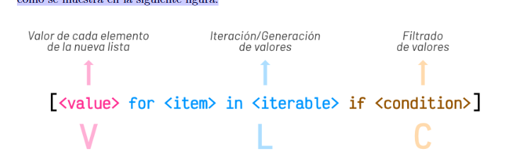

ºbgn

# Estructuras de datos

En las estructuras de datos son mutables, es decir se pueden modificar, añadir y borrar

Se pueden crear listas vacías, son dinamicas como las colecciones en Java.

Las listas permiten meter elemntos de cualquier tipo, incluso se pueden anidar listas.

La mejor forma de crear una lista vacia es con los corchetes

Para sacar un elemento = `lista[0]`

Empieza en el 0 y llega a uno menos, osea que empieza en el cero y termina en el dos `shopping[0:3]`

Poner la lista al reves conservando la lista original:

`shopping[::-1]` o `list(reversed(shopping))`

Modificando la lista original:

`shopping.reverse()` sin la "d" al final

`shopping.insert(1,  Jamón )` sirve para inserta la posición exacta que deseamos insertar, modifica la lista original

- Combinar listas, se puede hacer de dos formas:

1. modificnado la original:

shopinng + fruitshop

2. conservando la original

shoppig.extend(fruitshop)

En este caso hay que tener cuidado debido a que si le pasamos a extend una palabra puede pasar esto`

`[ Agua ,  Huevos ,  Aceite ,  L ,  i ,  m ,  ó ,  n ]`

Troceado puede ser que caiga en clase, por ejemplo aqui `shopping[1:4] = []`

## Ordenar listas:

Se puede ordenar conservando la lista original:

`sorted(shopping)`

o

Modificando la lista original:

`shopping.sort()`

- Enumerates:
  Hay veces que no sólo nos interesa «visitar» cada uno de los elementos de una lista, sino
  que también queremos saber su índice dentro de la misma. Para ello Python nos ofrece la
  función enumerate()

```python
for i, product in enumerate(shopping):
print(i, product)
```

- Zip:
  Dado que zip() produce un iterador, si queremos obtener una lista explícita con la
  combinación en paralelo de las listas, debemos construir dicha lista de la siguiente manera:

```python
list(zip(shopping, details))
```

Si hay una de las listas es mas larga, se para en la lista más corta.

## Comparar listas:

Comparar listas es raro así que hay que tener cuidado

## Cuidado con las copias:

Las listas son estructuras de datos mutables y esta característica nos obliga a tener cuidado
cuando realizamos copias de listas, ya que la modificación de una de ellas puede afectar a la
otra.
Veamos un ejemplo sencillo:

```python
original_list = [4, 3, 7, 1]
copy_list = original_list
original_list[0] = 15
original_list
[15, 3, 7, 1]
copy_list
[15, 3, 7, 1]
```

Una posible solución a este problema es hacer una «copia dura». Para ello Python
proporciona la función copy()

```python
copy_list = original_list.copy()
```

## Listas por comprensión

Las listas por comprensión establecen una técnica para crear listas de forma más
compacta basándose en el concepto matemático de conjuntos definidos por comprensión.
Podríamos decir que su sintaxis sigue un modelo VLC (Value-Loop-Condition) tal y
como se muestra en la siguiente figura:



Ejmplo sin compresión:

```python

for value in values.split( , ):
int_value = int(value)
int_values.append(int_value)

```

Ejemplo con compresión y compresion con condición :

```python

int_values = [int(value) for value in values.split( , )]

```

```python
int_values = [int(v) for v in values.split( , ) if v.startswith( 4 )]
```

# Listas bidireccionales 

`team[1][2]` --> selecciona el indice 1 de la lista y dentro de la lista del indice 1 selecciona el indice 2

`Team[3]` --> Selecciona solo una 

# Tuplas 

Son inmutables y ocupan menos espacios que las listas 

## Tuplas vs Listas
Aunque puedan parecer estructuras de datos muy similares, sabemos que las tuplas carecen de
ciertas operaciones, especialmente las que tienen que ver con la modificación de sus valores,
ya que no son inmutables. Si las listas son más flexibles y potentes, ¿por qué íbamos a
necesitar tuplas? Veamos 4 potenciales ventajas del uso de tuplas frente a las listas:
1. Las tuplas ocupan menos espacio en memoria.
2. En las tuplas existe protección frente a cambios indeseados.
3. Las tuplas se pueden usar como claves de diccionarios (son «hashables»).
4. Las namedtuples son una alternativa sencilla a los objetos.

nameTuplas: son objetos, pero sin tener que ser objetos

endº

